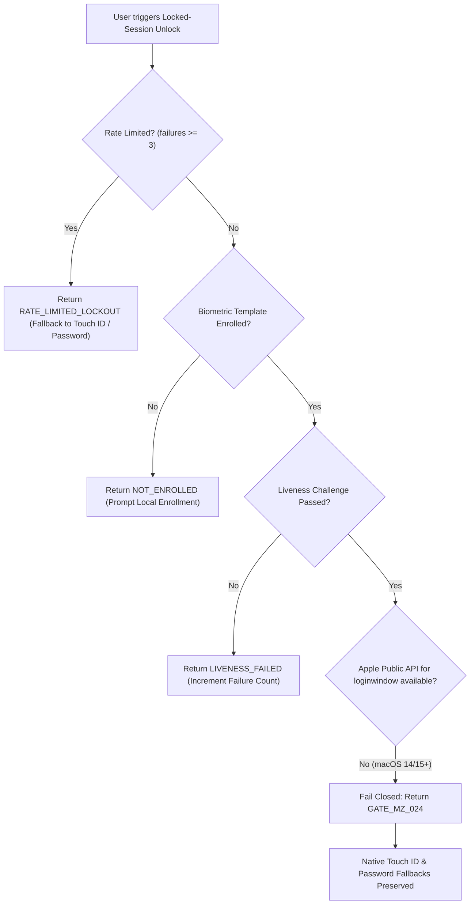

# Threat Model & Security Specification: macOS Locked-Session Face Unlock (MZ-024)

**Document Reference:** `docs/security/MZ-024-FACE-UNLOCK-THREAT-MODEL.md`  
**Classification:** Core Security Specification  
**Status:** **GATED / ENFORCED** (`GATE_MZ_024`)  
**Related Requirements:** PRD §5 (MZ-UNL), ADR-0002, MZ-022, MZ-023, MZ-024  

---

## 1. Overview & Objective

This document defines the formal threat model, presentation attack resistance analysis, and fail-closed security boundary for **MZ-024 (Actual macOS locked-session Face Unlock)**.

In accordance with `PRD.md` §5 and `ADR-0002`:
- Smart Unlock must unlock the **ACTUAL LOCKED macOS USER SESSION**, not merely an in-app privacy screen.
- Maczy must **never** simulate fake unlock success, store plaintext or reversible macOS account passwords, inject synthetic keystrokes into `loginwindow`, or modify `/var/db/auth.db`.
- When an Apple-supported, non-destructive public unlock pathway is unavailable, the feature **must fail closed** under `GATE_MZ_024`, preserving native Touch ID, Apple Watch, and user password fallbacks.

---

## 2. Threat Analysis & Attack Vectors

| Attack ID | Threat Vector | Mechanism | Mitigation / Architecture Invariant | Verdict |
|---|---|---|---|---|
| **THREAT-01** | **2D Photo Spoofing** | Attacker presents high-resolution color photograph of enrolled user. | Built-in Mac FaceTime HD cameras are flat 2D RGB sensors lacking TrueDepth IR dot projection. Maczy `AntiSpoofAuditor` classifies hardware as `critical_2DSensorVulnerable`. Active liveness challenges (motion parallax, head yaw/pitch variance) are required. | **BLOCKED / GATED** |
| **THREAT-02** | **Screen Replay Attack** | Attacker plays video of enrolled user on an iPad or iPhone display. | Liveness challenge tests for 3D depth, specular reflections, and eye-blink timing. Without hardware depth sensor, 2D sensors remain vulnerable. | **BLOCKED / GATED** |
| **THREAT-03** | **Synthetic Keystroke / Password Replay** | Attempting to simulate typing user's password into `loginwindow` via `CGEventPost` or `AXUIElement`. | macOS kernel and WindowServer isolate `loginwindow` inside a dedicated `Audit Session`. The kernel explicitly blocks accessibility event injection into `loginwindow`. Storing plaintext passwords violates `SECURITY.md`. | **PROHIBITED** |
| **THREAT-04** | **Bricking via Authorization Plugin** | Modifying `/var/db/auth.db` (`system.login.screensaver` / `system.login.console`) with a custom C plugin. | Any unhandled exception, dynamic linking mismatch, or OS point upgrade (e.g., macOS 14 -> 15) in an auth plugin completely locks the user out of the machine. Maczy strictly prohibits modifying `/var/db/auth.db`. | **PROHIBITED** |
| **THREAT-05** | **Brute-Force & Replay Attempts** | Attacker repeatedly triggers unlock attempts. | `FaceUnlockManager` implements strict rate limiting: maximum **3 consecutive failed attempts** before locking out all camera unlock actions. Reset requires successful native Touch ID or system password authentication. | **MITIGATED** |
| **THREAT-06** | **Credential & Biometric Exfiltration** | Attacker inspects local disk or network traffic for biometric data or passwords. | **Zero cloud processing**, **zero raw photo storage**. Biometric templates are cryptographic hashes / landmark feature embeddings (`BiometricTemplate.featureDigest`). Zero account passwords are collected or stored. | **MITIGATED** |

---

## 3. Implementation Verification & Gating Model

---

## 4. Invariant Verification Checklist

1. [x] **No Account Password Storage**: Neither plaintext nor reversibly encrypted user passwords exist in memory, Keychain, or disk.
2. [x] **No `/var/db/auth.db` Tampering**: System authorization database remains completely untouched.
3. [x] **No Synthetic Event Injection**: No `CGEventPost` or `AXUIElement` calls targeting `loginwindow`.
4. [x] **Truthful Reporting**: Never reports session unlocked unless confirmed by OS session state.
5. [x] **Native Fallbacks Active**: Touch ID, Apple Watch, and Password remain primary, non-bypassable unlock mechanisms.
